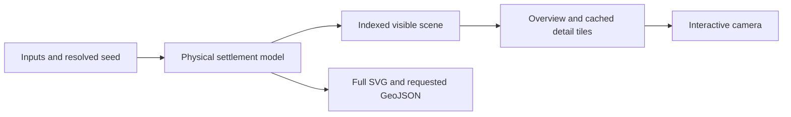

# Settlement generation and viewer design

Approved design, 15 October 2026. The paired engine and viewer implementation is described in [the implementation review](2026-10-15-generation-and-viewer-implementation.md), including measured results and remaining validation limits.

Build one coherent physical settlement, then display only the detail useful at the current scale. Denser streets, varied outskirts and inhabited farmland should improve the city without requiring the browser to repaint every roof during each gesture. Keep the complete model and full artwork available for exports.

The recommended sequence is immediate viewer relief, a shared model and rendering contract, then city-quality improvements and spatially filtered display in parallel. Use the existing physical planner as the foundation for new generation work; preserve legacy callers during a separately tested migration.

## Evidence and existing foundations

The two original investigations are the engine session `01a13f11-5cce-77b0-9ca2-185ffa6f3ea6` and web session `01a13f19-f935-7830-a45e-0d4d919dac43`. Their findings were reviewed against both checkouts by generation, viewer and architecture subagents.

| Baseline | Revision | Meaning |
| --- | --- | --- |
| Engine checkout | `89859eab47100cdd42c484820338c9a22d5efc36` | Package metadata 3.0.1; includes the subsequent physical-planner development preview |
| Web checkout | `5fc1e990988ee9260eb58b8917025b7f405be118` | Current local client source |
| Web engine submodule | `5160d59ba5b2475f97ccbe7b1eebbd0e51912052` | Engine 2.6.0; source used by the original browser probe |

The browser probe's 250,000-person fixture produced 6.29 MB of SVG, 40,376 descendant elements and 31,596 `use` instances. Mean gesture frame times were approximately 101 ms with live `viewBox` panning and 17 ms with CSS transforms; zoom was 118 ms versus 17 ms. A full-city viewport bitmap took approximately 836 ms to prepare. These are headless Chromium results at 1600 × 1000, DPR 1, with no CPU throttling; they establish a promising prototype, not production or mobile performance. The 250k fixture is a stress case above the builder's advertised 200k maximum. The 100k case also struggled, at approximately 43 ms per pan frame.

Source measurements and harness remain in `/tmp/settlemaker-render-investigation/`, particularly `investigation.txt`, `results.json` and `repeat-results.json`. Preserve them with the future benchmark harness before relying on that temporary directory. Benchmark the current engine and physical planner separately: the old timings cannot establish their costs.

Existing engine capabilities materially reduce the work:

- [createSettlementModel](../../src/settlement/generate.ts) already separates physical generation from SVG and GeoJSON creation. The convenience `planSettlement` still produces both outputs.
- [renderSettlement](../../src/settlement/output.ts) already supports viewport bounds, width and `detail: 'auto' | 'full'`. [sceneInView](../../src/settlement/render-view.ts) rejects offscreen items, but scans all items and retains complete water and walls.
- [assembleSvg](../../src/output/assemble-svg.ts) already substitutes building polygons and simpler vegetation when artwork is too small to see. Extend this rather than creating a second independent detail system.
- Physical city and village layouts already share `SettlementModel` and Scene. Legacy villages still have their separate renderer. The [physical contract](../settlement-planning.md) and [legacy scene contract](../scene-schema.md) must remain distinguishable.

## City generation

### Plan occupation and open space together

Use a small set of deterministic neighbourhood rules driven by access to roads and gates, distance through the district graph to the urban edge, water constraints and local land-use preferences. This should produce a recognisable progression from enclosed centre to suburbs and countryside without concentric rings or arbitrary glyph substitutions.

The planning order is land and water constraints, connected road corridors, civic and natural reservations, neighbourhood character, plots and buildings, resident allocation, then decorative artwork. Keep the current road/block solver and improve its inputs and local subdivision rules incrementally.

Any artwork fitting that changes building footprints must finish before final resident allocation. Subsequent decoration cannot remove accepted housing or alter its capacity.

For enclosed residential blocks, measure usable land and street frontage separately from population capacity. Reserve markets, palace and cathedral grounds, parks, courtyards and access before filling residential plots. Give each substantial remaining gap a reason: access, court, civic space, protected ground, deliberately vacant land or failed placement. Record failed placement rather than hiding it as a park. Perform bounded local infill where a standard house fits with access and clearance.

The current 10,000-person default core cap is a population-allocation policy; removing it alone will not fill gaps. Preserve explicit `corePopulation` requests. Introduce an opt-in compact-core policy that chooses enclosure size and building supply together, then calibrate it visually before changing defaults. Never report extra residents merely to make a map appear full, or inflate capacity to conceal insufficient housing.

### Keep architecture at a consistent physical scale

Choose archetypes with bounded dimensions: terrace houses, corner houses, workshop courts, detached cottages and agricultural compounds. Subdivide plots to fit those forms. A large plot should yield several appropriate structures or meaningful yard space. An unsuitable lot should retain a clear polygon fallback or be replanned locally.

Replace the current outskirts roof-shrinking rule with larger plots, fewer occupied frontages, increased spacing and different building arrangements. Small cottages remain a legitimate archetype, but density itself should not continuously scale every house down. Couple glyph caps to plot changes; capping artwork alone would leave the original lots visibly underfilled. Preserve catalogue anchors, footprint proportions, rotation and non-square `scaleY`.

Keep regional architectural consistency while selecting weighted neighbourhood palettes. A gate approach can have terraces and workshops, a market junction shop houses and courts, a fringe lane detached cottages and crofts, and a river corridor meadow or woodland where suitable. These are layout rules, not just roof colour variations. Blend their probabilities across neighbouring blocks and along streets rather than selecting one ward type for all suburbs.

### Reserve connected green areas and inhabited outskirts

Plan public parks, riparian strips, commons and woodland before housing consumes their land. Use area and access measures; ward counts alone do not describe how much green space exists. Distinguish public green space, private gardens, agricultural land and protected natural ground. A dense centre can coexist with substantial intentional green areas when coverage is measured on the remaining residential land.

Extend outer neighbourhoods into mixed dwelling-and-field plots, then hamlets and scattered farmsteads around useful lanes and junctions. Reserve their building footprints and access before agricultural parcel subdivision. Reuse the frontage and block primitives; do not invoke a complete settlement generator for each farm. Adopt or classify existing farm residences before allocating new rural capacity, since current physical resident accounting already includes eligible Farm geometry.

Population scope remains an explicit design choice from the [rural handoff](2026-09-13-rural-population-handoff.md). Recommended opt-in semantics: the input is total regional demand, with rural residents deducted from the same total. Keep the existing behaviour and zero new rural allocation as the compatibility default until this is selected. Compare 5%, 10% and 20% rural shares as visual experiments, not promised defaults. Any city-only population mode would need a separate explicit rural count. Always conserve requested = assigned + unassigned and expose urban/rural subtotals without double counting.

Urban/rural classification is separate from inside/outside walls. Keep both accounts and preserve explicit `corePopulation`; a rural allocation cannot silently borrow residents reserved for the enclosed core.

Represent planned woodland extent independently of decorative tree sampling. The current [landscape stage](../../src/settlement/landscape.ts) reduces actual tree placement density on large maps; display simplification alone cannot restore missing natural areas. First establish semantic woodland polygons, then use deterministic detail placement or bounded decorative sampling within them. Zoom must not change the area's identity or the resident model.

### Preserve a readable road hierarchy

Carry route identity and semantic importance from planning into Scene, alongside the physically reserved width. Existing `artery | road | alley` categories collapse local streets and service lanes; add optional role metadata with a legacy fallback rather than silently changing existing kinds.

Render important routes with an overview contrast/width floor and progressively reveal local lanes. Screen-space emphasis is cartography; it must not change ground geometry or exported physical widths. Test it against dense roofs, walls, water and every supported palette. Preserve gate, bridge and frontage connections through all layout changes.

## Interactive display

### Immediate improvement on the current web baseline

Clear the render debounce before explicit Generate or Random actions, deduplicate equivalent requests, initialise controls before generation, and retain the last accepted map while preparing its replacement. Use one camera update per animation frame with cached viewport measurements invalidated on resize.

Prototype CSS transforms during drag, wheel and pinch. Preserve cursor anchoring and pinch-centroid movement; use overscan to cover newly exposed edges. Refresh a sharp view when interaction settles, keeping the old image until the replacement is ready. Full-SVG repaint at the end remains an intermediate limitation. Browser rendering guidance explains why transforms can avoid repeated layout and paint, but actual compositing must be verified on the supported browsers. [Rendering performance](https://web.dev/articles/rendering-performance)

Prepare replacement SVGs off-document or in isolated image documents so duplicate glyph IDs and styles cannot interfere with the accepted map during a swap.

Move generation into one persistent worker. Keep at most one active generation and one replaceable pending request. Request IDs prevent stale results from replacing newer accepted work. A cancel message cannot interrupt a synchronous generator that has not yielded: use stale-result rejection normally and terminate/restart for explicit cancellation or a measured excessive obsolete-job delay. Cooperative cancellation can follow if profiling justifies it. Workers keep UI code responsive but do not remove SVG insertion or paint costs. [Using Web Workers](https://developer.mozilla.org/en-US/docs/Web/API/Web_Workers_API/Using_web_workers)

Keep accepted and candidate state separate, with explicit commit and disposal. Cached overview and tiles remain interactive during synchronous replacement generation, but that worker cannot simultaneously service uncached old-map detail. Initially scope detail-refresh deadlines to an idle generator; test navigation into uncached territory during regeneration. If that pause is unacceptable, measure a separate rendering worker with one-time model transfer. Worker termination must retain the accepted SVG/overview and either restore a saved serializable model or reconstruct it before servicing new detail requests.

### Scalable display through filtered artwork

The first durable renderer should be a low-detail overview under cached raster tiles produced from spatially filtered Scene data and the existing SVG assembler. It has the strongest path to artwork parity. Keep Canvas 2D glyph atlases as a measured challenger if tile preparation misses the budgets; defer WebGL until there is evidence that it is required.

1. Build an immutable geometry index once per accepted model. Query visible bounds plus overscan and current paint extents; do not repeat an entire-scene scan for every tile. Alternatively, rebuild a separate painted-bounds index on appearance changes. Include lines crossing the view even when both endpoints lie outside it.
2. Query conservative painted bounds, including rotated glyph extents, anchors, shadows, strokes and skin artwork. Current fixed padding is a starting point, not a sufficient general contract. Preserve building/glyph pairs and painter order.
3. Render isolated SVG tile documents with required definitions only. Retain world-space pattern origins and water polygon/hole grouping. Add padded gutters and crop to the tile interior to avoid seams and double-painted shadows. Treat large water and wall structures separately where useful, without duplicating complete geometry into every tile.
4. Cache by scene revision, renderer/asset revision, appearance, detail tier, resolution/DPR tier and tile coordinates. Prioritise visible gaps; defer prefetch during interaction; discard obsolete jobs. Keep overview coverage until tiles are ready.
5. Select detail from projected physical size, with hysteresis between levels. Overview retains urban mass, major roads, water, parks, walls and landmarks; neighbourhood scale reveals individual footprints; close view restores full glyphs. Keep a small overlay for labels, focus and future feature interaction.

Use `OffscreenCanvas` only after feature and SVG-decode capability checks. Its availability does not prove the entire SVG-to-bitmap pipeline works in a worker. A supported fallback can perform bounded image decode and canvas work on the main thread while generation stays in the worker. Release discarded `ImageBitmap` objects and Blob URLs. [OffscreenCanvas](https://developer.mozilla.org/en-US/docs/Web/API/OffscreenCanvas)

If raster presentation fails, retain the transformed SVG viewer. If worker startup fails, retain the accepted map and offer retry or explicit synchronous Generate; do not repeatedly block the page through automatic retries.

Start experiments with 512 CSS-pixel tiles, opportunistic overscan and a byte-based least-recently-used cache. A 512-pixel tile at DPR 2 occupies about 4 MiB of raw RGBA storage before gutters and other copies. Trial aggregate steady decoded-display budgets of 32 MiB on constrained devices and 64 MiB on desktop, including overview, tiles and glyph caches. Count in-flight buffers in the overall peak budget; reduce overscan, prefetch or render scale before exceeding it. A 4096-square export canvas alone requires approximately 64 MiB of raw RGBA storage, so measure and budget export peaks separately. These are tunable starting points, not measured device limits.

A Canvas challenger must also preserve SVG shadow-group compositing: rendering each building shadow with its own alpha changes the darkness of overlaps. Composite the shadow layer with the same group opacity as the reference renderer.

Do not use the current SVG crop helper as a spatial partitioner: it retains the complete scene. Do not rasterise the entire city at maximum zoom, and do not weaken generated geometry to meet a display budget.

### Export and print stay tied to the accepted map

Keep the complete full-detail SVG string and original bounds with every accepted map. Commit display, diagnostics and export source atomically by request ID. Defer expensive DOM parsing, image decode and PNG rasterisation until needed; GeoJSON should be requested only when needed. This retains full-SVG serialization cost; native Print compatibility remains gated on the prepared-raster or validated cold-resource fallback below.

For the physical planner, full export requires `renderSettlement(model, { bounds: originalBounds, detail: 'full', ...appearance })`; its default preview is simplified. Export must never capture the user's current crop or a low-detail overview.

The application's Print button can await preparation. Native `beforeprint` cannot await a worker: use a prepared print raster, or synchronously attach a standalone full-map image backed by the retained SVG. Validate that cold-resource path in each supported browser. Retain existing preload behaviour where it is necessary until a working replacement is proven. Idle scheduling alone does not solve this contract.

## Contract between repositories

Keep `SettlementModel` authoritative in its worker; avoid cloning the entire model on every camera movement. Add a small versioned worker protocol, not a replacement public geometry model:

| Message or record | Required information |
| --- | --- |
| Generate | Request ID, generator revision, normalized inputs, resolved seed, planner mode and development options, resolved appearance/revision, skin JSON when used, requested outputs |
| Accepted map | Scene and appearance revisions, engine/planner/schema versions, coordinate-system and scale provenance, original bounds, full SVG, diagnostics, resident summary and stage timings |
| View request | Scene and camera revision, bounds, CSS size, DPR, appearance revision and detail policy |
| View response | Matching revisions, actual rendered bounds/detail and SVG or transferable bitmap |
| Export request | Accepted scene revision, format and full-detail options |
| Failure | Request/revision identity and diagnostic; previous accepted map remains available |

Use existing model/render/export APIs for physical plans. For legacy callers, add an output-selective path or a shared internal generation helper that preserves validation, origin shifts and diagnostics; do not reproduce the coastal two-pass logic in client code. Default public convenience results remain compatible.

Current IDs are stable within the same generated scene, not a promise across generator revisions or arbitrary topology changes. Use a scene revision in every cache key. Record resolved seeds because changing an unseeded name changes generation. A palette edit can reuse geometry; skin changes that alter base-biome behaviour cannot be assumed cosmetic. Recreate validated skins from JSON inside the worker because runtime handles use module-local state.

Legacy scene units and physical metres must never be conflated. Preserve origin shifts and water/route diagnostics through adapters. Export schema versions, scene versions, worker protocol versions and generator revisions have distinct purposes. Additive metadata can preserve old formats; changed coordinate meaning requires an explicit versioned contract.

Structured diagnostics require engine work: the current physical model exposes string diagnostics and does not carry the complete legacy `waterContextResult` envelope. Preserve applicable structured water/degradation information and source-input provenance in the adapters rather than reconstructing it from diagnostic text.

The web production build deliberately loads the library separately through `/lib/settlemaker.js`. Workers cannot rely on the document's import map. Supply an explicit, version-aligned library URL and test the production merge output as well as development aliases; preserve the existing separate library artifact. [Import map scope](https://developer.mozilla.org/en-US/docs/Web/HTML/Reference/Elements/script/type/importmap)

Require a startup handshake reporting the actual protocol, engine and artwork revisions. Prefer immutable version-addressed library assets. If an older open page restarts against a new deployment, reject incompatible revisions with a clear reload/retry path instead of trusting the requested version. Retain a tested rollback pin for the engine/web pair.

## Implementation sequence and ownership

| Step | Engine work | Web work | Exit condition |
| --- | --- | --- | --- |
| 0. Reproducible baselines | Freeze seed/input matrix for pinned legacy, current legacy and physical city/village; stage timings and visual crops | Preserve browser harness; cold/warm load, pan/zoom and memory probes on production artifacts | Revision-labelled baseline and agreed quality examples |
| 1. Immediate relief | No generator migration required | Debounce fixes, controls first, transform gestures, print preparation changes with fallback | Same maps/exports; interaction gain confirmed without blank edges or print regression |
| 2. Shared integration | Retain model; optional outputs for legacy; versioned metadata, diagnostics and timings | Persistent worker, request lifecycle, atomic commit, appearance reuse, explicit module URLs | Stale/cancel/error paths pass; both app entry points work in production build |
| 3A. City quality | Physical scale and plot rules; reserved land and compact core; neighbourhood variation, greens and rural fringe in successive changes | Add an explicit planner preview and matching URL/state handling | Geometry, resident accounting and fixed-scale visual gates pass |
| 3B. Spatial display | Spatial index, painted bounds, semantic road metadata and existing LOD improvements | Overview plus filtered tiles; memory budget and Canvas challenger | Frame, refresh, memory and full-artwork parity gates pass |
| 4. Coordinated release | Version and release the tested engine; preserve legacy path | Update the pinned submodule deliberately; adopt the physical planner separately from viewer rollout | Dense physical fixtures pass full production/browser/export matrix |

Steps 3A and 3B run in parallel after the shared contract is stable. Begin each with a representative dense city so viewer validation does not use an unrealistically cheap map. Ship narrow improvements independently where their exit conditions pass.

Profile model generation before optimizing it. Record topology, roads, plot subdivision, retries, glyph fitting, landscape, scene/index construction, SVG and GeoJSON separately. Likely candidates include repeated full `blockLayout` attempts, repeated glyph fitting and repeated spatial scans, but these are hypotheses until measured. Prefer cached immutable intermediates, spatial queries and bounded local repair over global reruns. Use stage- or entity-derived random streams for new algorithms, with a generator revision change where outputs change. Never parallelise shared RNG mutation or make results depend on tile request order.

## Acceptance and decision gates

Use a fixed representative suite: small village, 1,000-person village, explicitly selected 300/800/2,000-person cities, 10k/50k/100k/200k cities and 250k stress case; include multiple fixed and held-out seeds, water-constrained and inland sites, varied approaches, walls/no walls, sparse and compact policies, biomes, skins and custom shadows. Compare a curated subset on every change and the full suite at integration. Test Chromium, Firefox and Safari, DPR 1 and 2, and at least one named constrained real device. Keep cold and warm measurements separate.

| Area | Required checks |
| --- | --- |
| Dense core | Total enclosure roof coverage and coverage of buildable residential land; occupied accessible street frontage; area and cause of residual gaps; separate civic/green reservations |
| Building scale | Physical width/depth distributions by archetype and zone; distortion and fallback rates; roof silhouette coverage at fixed metres-per-pixel |
| Suburbs and fringe | Neighbourhood form distribution; occupied frontage and dwelling density along several road/edge transects; rural clusters with access and conserved residents |
| Green areas | Public/private/natural area separately; accessibility and connected components; no building overlap; intentional preservation in core and suburbs |
| Roads and geometry | Gate-to-centre readability at overview; connected access; water/bridge correctness; no new forbidden overlap; export geometry matches model |
| Detail and tiling | Same feature identities across zoom; restored close-up artwork; tile-border, pattern, transparency, water-hole and custom-shadow parity against full SVG; a theme change casting an off-tile building's shadow into view |
| Lifecycle | Rapid edits, Random plus pending debounce, stale response, cancellation, worker failure/version mismatch, resize and theme change; uncached navigation during regeneration; atomic map/export identity and repeated regeneration |
| Compatibility | Legacy URLs, explicit planner URLs, builder and `/fmg`, embedded behaviour, SVG/PNG/native Print, dev and production worker import paths |

Proposed performance targets, to be calibrated on named devices: desktop gesture p95 at or below 20 ms and constrained-device p95 at or below 33 ms; sharp visible-region refresh within 250 ms desktop / 500 ms constrained device after settling; controls responsive within 100 ms while generation continues. Track worst frames and long tasks as well as p95. These are targets, not measured achievements. Record first useful map and full-detail readiness separately, and set their budgets after measuring the physical planner. Require bounded cache usage without sustained growth through repeated navigation and regeneration.

Calibrate numerical visual thresholds from reviewed maps at the same physical scale. Do not substitute an arbitrary universal roof-coverage percentage for the requested city character. Resident conservation, access, geometric validity and deterministic replay are hard gates; aesthetic improvement requires side-by-side overview, street and fringe review.

If filtered tiles meet these gates and match the artwork, keep that renderer. If their preparation or memory costs fail, compare Canvas 2D glyph-atlas rendering on exactly the same accepted scenes. Measure decode, raster, transfer and final presentation separately. A faster gesture demo alone is insufficient to choose a renderer or approve the planner migration.
